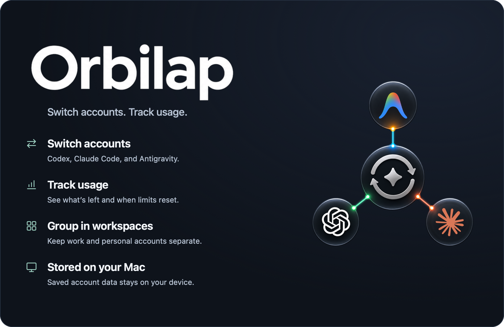
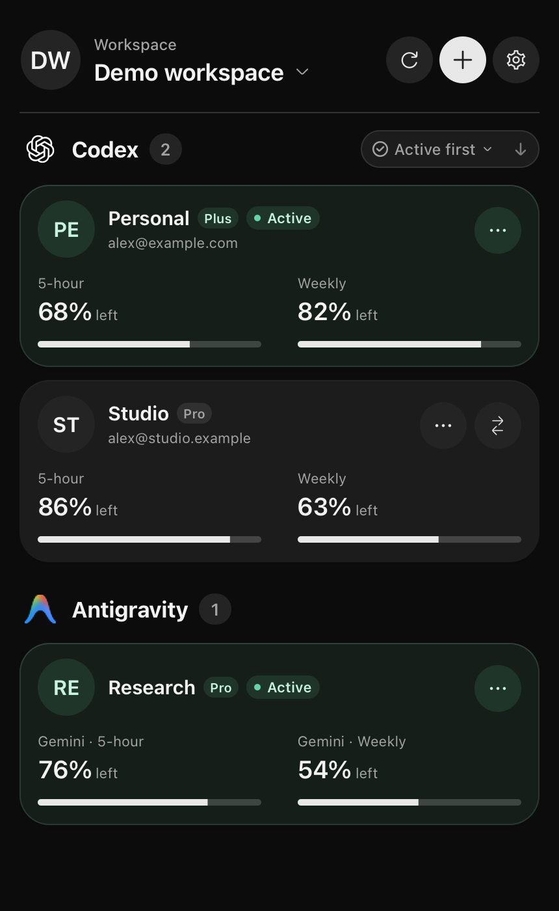

<p align="center">
  <a href="docs/assets/orbilap-overview.webp"></a>
</p>

<!-- badges:start -->
[](package.json)
[](src-tauri/tauri.conf.json)
[](LICENSE)
<!-- badges:end -->

Switch between saved Codex, Claude Code, and Antigravity accounts from your Mac’s menu bar. Track remaining usage and reset times, and organize accounts into workspaces.

## Orbilap in action

<p align="center">
  <a href="docs/assets/orbilap-panel.png"></a>
</p>

## Install on macOS

Orbilap supports macOS 12 or later.

1. Download Orbilap for [Apple Silicon (M-series)](https://github.com/amirmahdinezhad/orbilap/releases/download/v1.0.0/Orbilap_1.0.0_aarch64.dmg) or [Intel](https://github.com/amirmahdinezhad/orbilap/releases/download/v1.0.0/Orbilap_1.0.0_x64.dmg), or browse [GitHub Releases](https://github.com/amirmahdinezhad/orbilap/releases).
2. Open the DMG and drag **Orbilap.app** into **Applications**.
3. Open Orbilap, create a workspace, and add your accounts.

Orbilap uses ad-hoc signing. It has no Apple Developer ID signature or notarization. If macOS blocks the first launch of a copy you trust, remove quarantine from that app bundle and open it:

```sh
sudo xattr -dr com.apple.quarantine "/Applications/Orbilap.app"
open "/Applications/Orbilap.app"
```

## Updates

Open **Settings → Updates** and choose **Check for updates**. Read **What's new**, then **Download**. Choose **Install & relaunch** when you're ready.

## Remove the app and its data

Quit Orbilap and remove `Orbilap.app`. To forget saved Orbilap accounts and
workspaces too, remove `~/Library/Application Support/com.7skylab.orbilap`.
A new installation then starts with setup. Provider CLI sign-ins remain with
their own apps and are added only when you select them during setup.
See [Local data](docs/DEVELOPMENT.md#local-data) for preferences and legacy paths.

[Development](docs/DEVELOPMENT.md) · [Testing](docs/TESTING.md) · [Architecture](CONTRACT.md) · [Security](docs/SECURITY.md) · [Releasing](docs/RELEASING.md)

## License

Orbilap's original code is available under the [MIT License](LICENSE).
Third-party code and assets retain their own licenses. In particular, the
[shadcn/studio UI component notice](src/components/ui/LICENSE.md) includes
Commons Clause restrictions; those components are not relicensed by Orbilap's MIT license.
